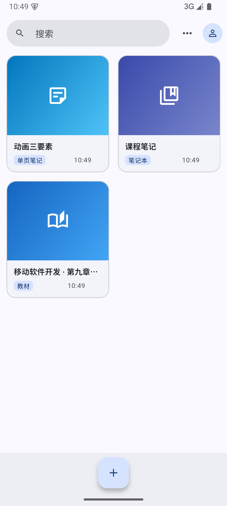
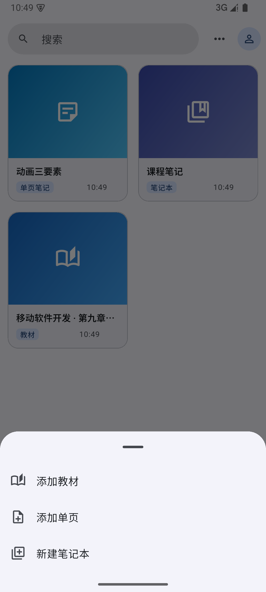
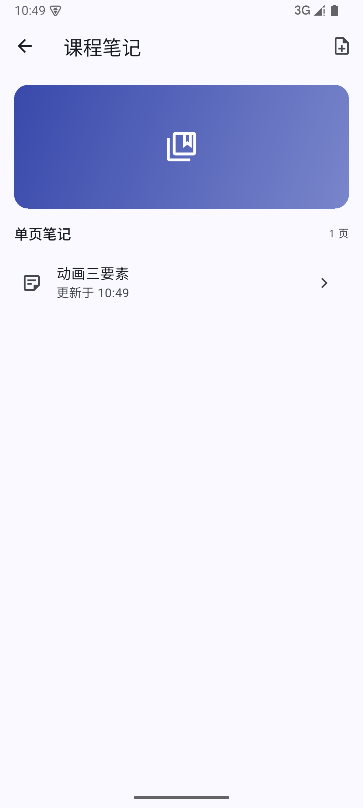
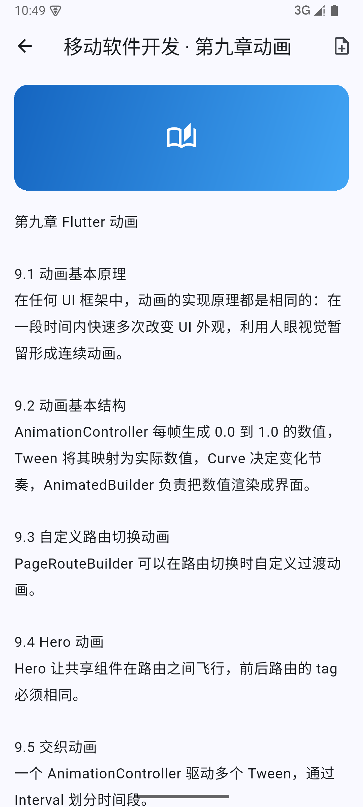
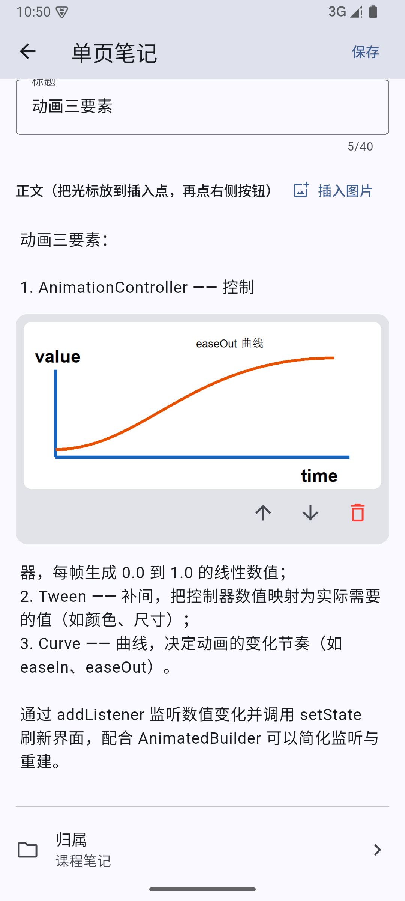
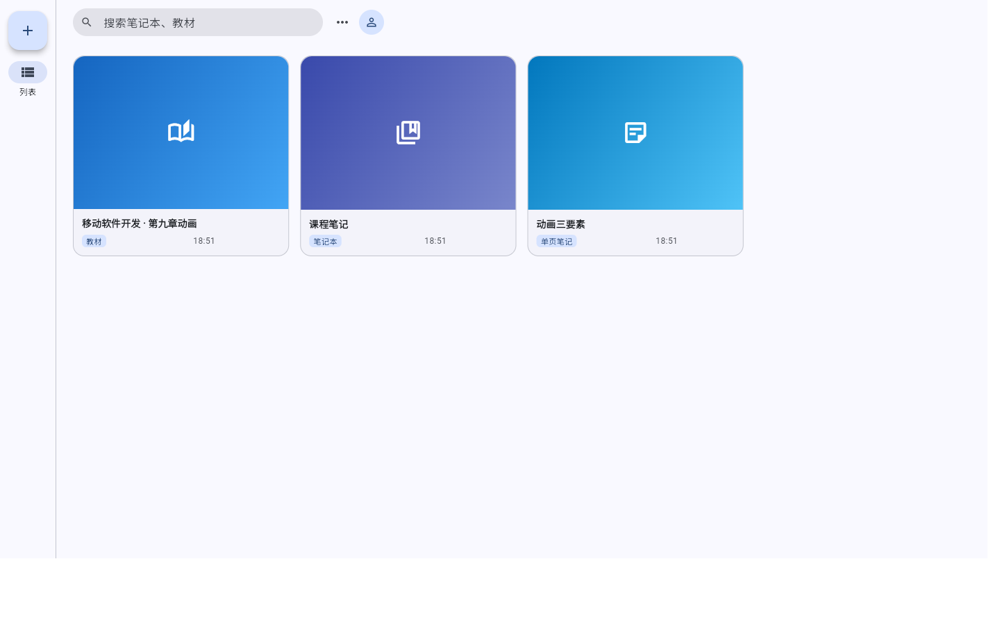

# 电子笔记本（eNoteBook）

一个基于 Flutter 的电子笔记本课程作业，同时支持 **Android 手机** 与 **Web 浏览器**。
应用把「教材、笔记本、单页笔记」三类内容统一成卡片展示，并大量使用《Flutter 实战》第 9 章讲解的动画机制实现页面过渡与交互动效。

- 技术栈：Flutter 3.x / Material 3 / pdfx（PDF 页面渲染）
- 主题色：`#1565C0`（Material 3 `colorSchemeSeed`）
- 数据：本地持久化（Android 端使用 SharedPreferences，Web 端使用 localStorage），重启或刷新后自动恢复

---

## 扫码下载 Android 版

<p align="center">
  
</p>

<p align="center">手机扫码即可下载安装包（v1.2.0，约 48.4 MB）</p>

也可以直接打开 [Releases 页面](https://github.com/handsome-lyl/eNoteBook/releases/latest) 下载 APK。

> 安装时如提示「未知来源应用」，在系统设置中允许该来源安装即可。

---

## 功能特性

### 1. 三类内容统一管理

| 类型 | 说明 |
| --- | --- |
| 教材 | 导入本地文件生成，可滚动阅读全文 |
| 笔记本 | 作为容器，用于归类单页笔记 |
| 单页笔记 | 独立的笔记页，可归属到某个笔记本或教材，也可不归属 |

主页以卡片网格混排展示全部内容，并按更新时间倒序排列。

卡片右上角的「⋮」菜单可删除条目：删除教材或笔记本时，其下的单页笔记会一并删除，删除前有二次确认。笔记本详情页的每一页笔记也可单独删除。

### 2. 教材导入

- 支持 `.txt`、`.md`、`.pdf` 三种格式
- 文本文件按 UTF-8 解码（容错模式），以文字方式滚动阅读
- PDF 教材按页原样渲染，文字、插图、表格、公式与版式完整保留，不会出现乱码或插图丢失
  - Android 使用系统 `PdfRenderer` 渲染，无需额外原生库
  - Web 使用内置的 PDF.js（静态资源随项目打包在 `web/pdfjs/`，无需访问外网）
  - 阅读页支持双指缩放、滚动翻页
- 导入后可重命名教材

### 3. 单页笔记编辑

- 标题 + 正文
- **图片可插入到正文任意位置**：把光标放到插入点，点击「插入图片」，图片会精确嵌入该位置，原文被自动拆成「光标前」「光标后」两段
- 插入后光标自动落到图片下方的文字段，可以直接继续输入
- 图片支持上移 / 下移 / 删除；删除后两侧文字自动合并
- 可选择归属到某个笔记本或教材

### 4. 搜索

顶栏搜索框支持按关键词检索，匹配范围是**笔记本与教材的标题**，实时过滤卡片列表。

### 5. 历史记录

头像菜单中的「历史记录」列出全部单页笔记，按创建时间倒序，点击可直接打开。

### 6. 登录 / 注册

本地校验，不联网：用户名不能为空、密码不少于 6 位。登录成功后，右上角头像显示用户名首字母，菜单变为「退出登录」。

### 7. 响应式布局

| 窗口宽度 | 布局 |
| --- | --- |
| < 600（手机） | 顶部栏 + 底部「＋」按钮 |
| ≥ 600（平板 / 桌面浏览器） | 左侧 NavigationRail + 顶部栏 |

卡片网格列数随宽度自适应：2 / 3 / 4 / 5 列。

### 8. 本地存储

- 全部条目（教材、笔记本、单页笔记）序列化为 JSON 写入本地，图片以 Base64 编码随笔记保存
- Android 端写入 SharedPreferences，Web 端写入 localStorage（`shared_preferences`）
- 首次启动且没有存档时写入示例数据；存档损坏时自动回落为示例数据
- 每次新增、编辑、删除都会自动保存，笔记编辑页点击「保存」时同步落盘

---

## 动画实现（对应教材第 9 章）

| 章节 | 实现内容 | 代码位置 |
| --- | --- | --- |
| 9.3 自定义路由切换动画 | 淡入 + 右滑的 `PageRouteBuilder` 页面过渡 | `lib/app_route.dart` |
| 9.4 Hero 动画 | 卡片封面与详情页封面共用 `Hero` tag，实现飞行过渡 | `lib/widgets/entry_cover.dart` |
| 9.5 交织动画 | 卡片按索引使用 `Interval` 分段入场 | `lib/pages/home_page.dart` |
| 9.7 隐式动画 | 卡片 hover 的 `AnimatedScale`、阴影 `AnimatedContainer`、空状态与网格切换的 `AnimatedSwitcher` | `lib/widgets/entry_card.dart`、`lib/pages/home_page.dart` |

---

## 界面预览

### 手机端（Android）

| 主页 | 添加菜单 | 笔记本详情 |
| --- | --- | --- |
|  |  |  |

| 教材阅读 | 单页笔记编辑（图片嵌入正文） |
| --- | --- |
|  |  |

### 网页端（桌面浏览器，宽屏布局）



宽屏下自动切换为左侧导航栏布局，卡片按窗口宽度排列为多列网格。

---

## 运行与构建

### 环境要求

- Flutter SDK 3.x
- Android SDK（构建 APK 时需要）

### 本地运行

```bash
flutter pub get
flutter run
```

指定设备运行：

```bash
flutter devices                 # 查看可用设备
flutter run -d emulator-5554    # Android 模拟器
flutter run -d chrome           # 浏览器
```

### 构建发布版本

```bash
# Web
flutter build web --release
# 产物：build/web
# 本地预览：python -m http.server 8000 --directory build/web

# Android APK
flutter build apk --release
# 产物：build/app/outputs/flutter-apk/app-release.apk
```

### 测试与静态检查

```bash
flutter analyze
flutter test
```

当前共 25 个测试用例，覆盖主页渲染、响应式断点、搜索、登录、历史记录、路由跳转、正文块（文字 / 图片）解析与序列化、本地存储编解码与恢复，以及 PDF 文本提取。

---

## 项目结构

```
lib/
├── main.dart                    # 应用入口与 Material 3 主题
├── app_route.dart               # 自定义路由过渡动画（第 9.3 节）
├── models/
│   └── entry.dart               # 条目模型：教材 / 笔记本 / 单页笔记
├── store/
│   ├── app_store.dart           # 数据仓库、示例数据与保存调度
│   ├── entries_storage.dart     # 本地存储读写（SharedPreferences）
│   └── store_codec.dart         # Entry 与 JSON 互转（图片 Base64）
├── pages/
│   ├── home_page.dart           # 主页：响应式布局、搜索、卡片网格
│   ├── notebook_detail_page.dart# 笔记本详情与笔记列表
│   ├── textbook_reader_page.dart# 教材阅读（PDF 按页渲染 / 文本滚动）
│   └── note_editor_page.dart    # 单页笔记编辑（文字 + 图片混排）
├── widgets/
│   ├── entry_cover.dart         # 卡片封面（Hero）
│   ├── entry_card.dart          # 卡片（隐式动画）
│   ├── add_sheet.dart           # 底部添加菜单
│   └── dialogs.dart             # 命名对话框
└── utils/
    ├── content_blocks.dart      # 正文块解析与序列化
    ├── pdf_store.dart           # PDF 文件保存 / 读取（IO 与 Web 分支）
    ├── pdf_extract.dart         # 纯 Dart PDF 文本提取（工具与测试）
    └── format_time.dart         # 时间格式化

test/
├── widget_test.dart             # 主页与响应式布局
├── flow_test.dart               # 搜索 / 登录 / 历史记录等流程
├── entry_card_test.dart         # 卡片交互
├── content_blocks_test.dart     # 正文块解析与图片索引
├── store_codec_test.dart        # 条目 JSON 编解码
├── persistence_test.dart        # 本地存储写入与恢复
└── pdf_extract_test.dart        # PDF 文本提取
```

---

## 说明与限制

- **本地存储容量**：Android 端数据存于 SharedPreferences，容量充足；Web 端存于 localStorage，浏览器一般限制在 5 MB 左右，插入大量图片后可能保存失败（会提示「存储空间可能不足」）。
- **PDF 教材**：导入时保存原始 PDF 文件并按页渲染，完整还原文字与插图；Android 端文件保存在应用文档目录，Web 端为会话内存，刷新页面后需重新导入。原纯文本渲染与 `lib/utils/pdf_extract.dart` 保留作为工具与测试用途。
- **图片存储**：图片以 Base64 字符串随笔记保存在本地存储中，未单独写入文件或数据库。
